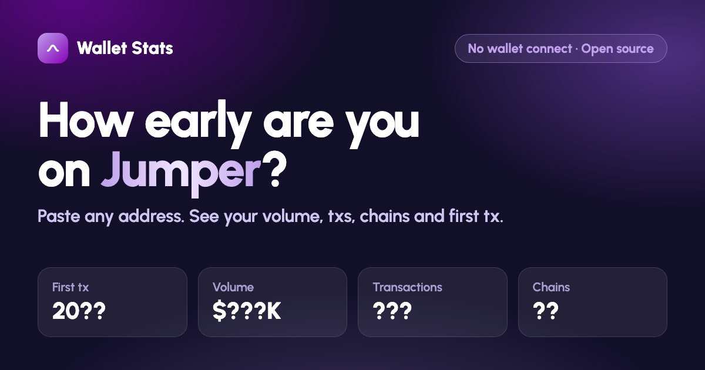

# Jumper Wallet Stats

**How early are you on Jumper?** Paste any EVM address and see your Jumper / LI.FI history: volume, transactions, bridges, swaps, chains and your very first tx.

**Live:** https://wallet-stats-checker.vercel.app



## Why it's safe

- **No wallet connection.** There is no "Connect wallet" button. You paste a public address, that's it.
- **No signatures, no approvals.** The page never asks your wallet for anything.
- **Nothing is stored.** No backend, no database, no analytics. Addresses go straight from your browser to the public LI.FI API.
- **One file.** The whole app is [`index.html`](index.html), about 400 lines of plain HTML/CSS/JS. Read it in 5 minutes.

## Features

- Check many wallets at once (one per line)
- **Jumper only** or **All LI.FI** mode (LI.FI also powers MetaMask Bridge, Rabby and others)
- Per-wallet: txs, volume (USD sent), bridges vs swaps, first/last tx, active months, chains
- Totals across all wallets, sortable table, CSV export
- **Share card** for X: a clean image with your combined stats and no addresses on it

## How it works

Data comes from the public LI.FI endpoint:

```
GET https://li.quest/v1/analytics/transfers?wallet=<address>&fromTimestamp=1500000000
```

- Only completed (`DONE`) transfers are counted.
- "Jumper only" keeps transfers where `metadata.integrator` starts with `jumper` (`jumper.exchange`, `jumper.exchange.gas`).
- Volume = sum of `sending.amountUSD` where the wallet is the sender.
- Bridge = source chain differs from destination chain, otherwise swap.

## Run locally

```bash
python3 -m http.server 8000
```

Then open http://localhost:8000.

## Disclaimer

Unofficial community tool. Not affiliated with Jumper or LI.FI. Numbers come from the LI.FI API as-is and say nothing about any airdrop or allocation.

## License

MIT
